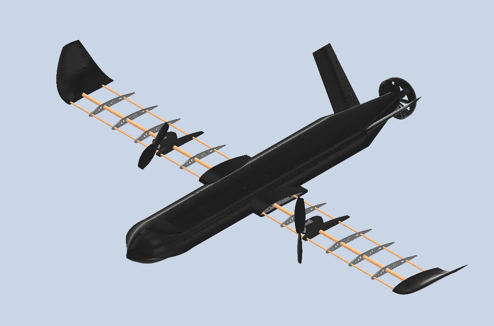
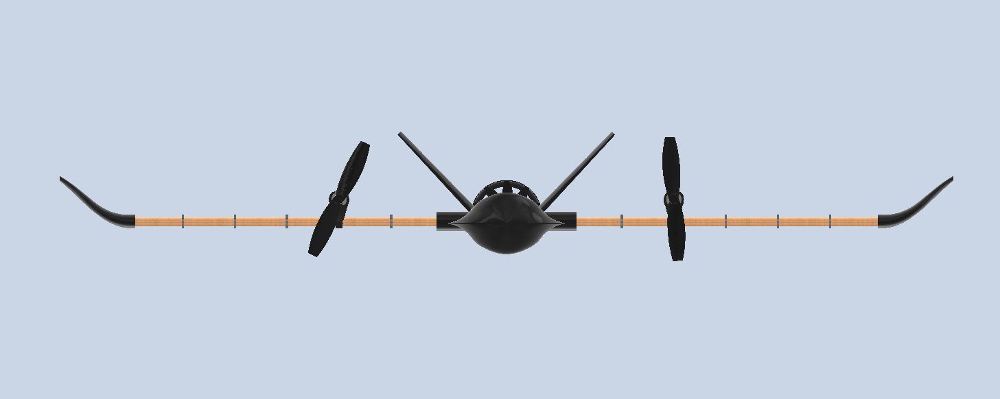
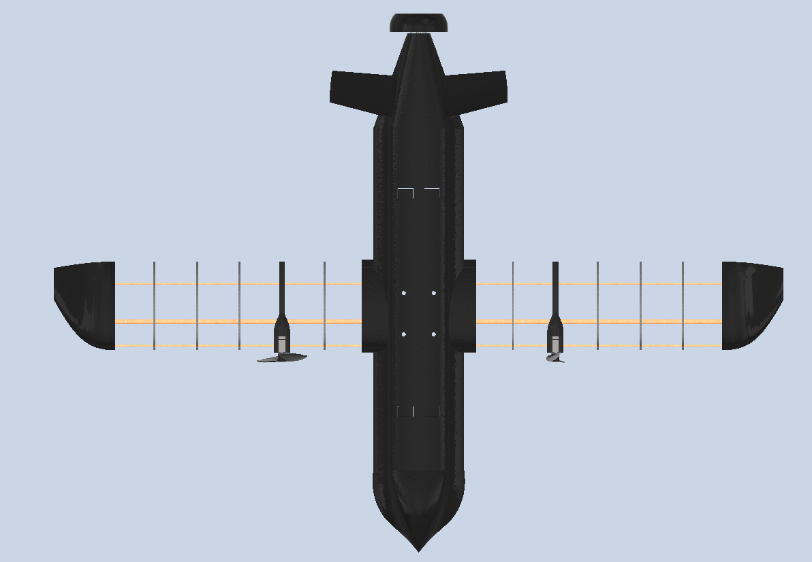
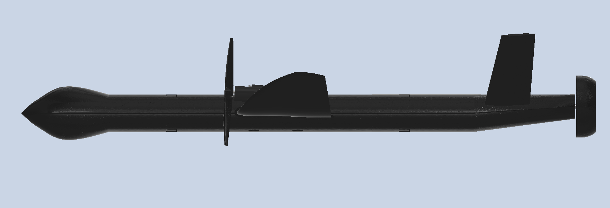
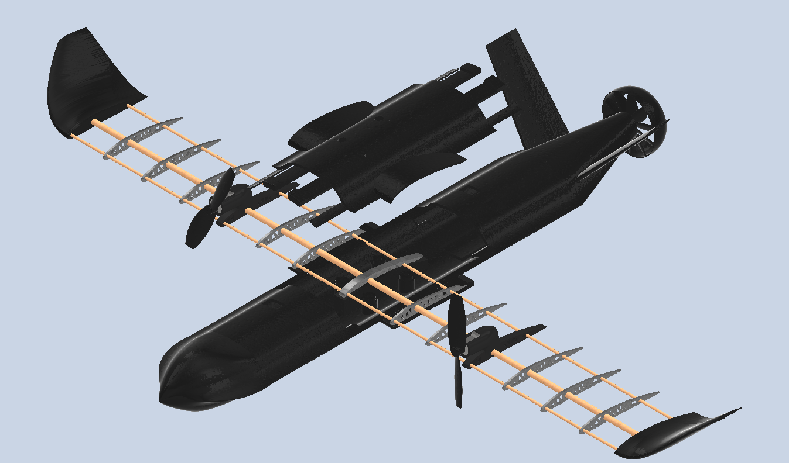

# Fixed-Wing Drone CAD Design

Full mechanical design of a drone in **Autodesk Inventor**: fuselage, wing structure with ribs, wingtips, motors, custom propellers and hardware.

<!-- TODO: add 1-2 sentences of context: personal, university or team project? What is the drone's mission? -->



## Views

| | |
|---|---|
|  |  |
|  |  |

## Specifications

<!-- TODO: fill in what you have; delete the rows that don't apply -->

| | |
|---|---|
| Wingspan | — |
| Length | — |
| Estimated weight | — |
| Propulsion | — |
| Manufacturing | — (e.g. 3D printing, 4 mm and 8 mm rods) |

## Components

The main assembly is **[`PARTS/DRONE.iam`](PARTS/DRONE.iam)**.

| Group | Parts |
|---|---|
| **Fuselage** | `MORRO` (nose), `COLA_v2` (tail), `ENCASTRE_FUSELAJE_superior` / `_inferior` (upper/lower fuselage mounts) |
| **Wing** | `COSTILLA_CENTRAL`, `COSTILLA_GENÉRICA`, `COSTILLA_MOTOR` (central, generic and motor ribs), `funda ala` (wing skin), `costilla 8_agujerosGrandes` (sub-assembly) |
| **Wingtips** | `WNGTIP_DERECHO` (right), `WNGTIP_IZQUIERDO` (left) |
| **Propulsion** | `Motor_ALA` (wing motor), `Rotor_MOTORES_ALA` (wing motor rotor), `MOTOR_TRASERO` (rear motor) |
| **Propellers** | `HELICE_BRANDO`, `HELICE_BRANDO_INVERSA` (counter-rotating), `HELICE_BRANDO_FAN`, `HELICE_BRANDO_FAN_MITAD` |
| **Hardware & structure** | `tornillo` (screw), `tuerca` (nut), `varilla 4mm` / `varilla 8mm` (rods), `Component2` |

## How to open it

1. Clone or download the **whole** repository: the assembly uses relative paths to the parts.
2. Open `PARTS/DRONE.iam` with **Autodesk Inventor** <!-- TODO: state the version, e.g. 2024 -->.
3. If Inventor cannot find a part, point the project (`.ipj`) or the file search path to the `PARTS/` folder.

> `.ipt`/`.iam` files can only be opened with Inventor. To view them without a license, use **Autodesk Viewer** (free, in the browser) or **Inventor Read-only Mode**.

## Structure

```
.
├── IMAGES/          # Renders and views of the design
└── PARTS/
    ├── DRONE.iam    # Main assembly
    ├── HELICES/     # Propeller designs
    └── *.ipt        # Parts
```

## Author

**Brando Fraiz Freire** · [@bran2ff](https://github.com/bran2ff)
